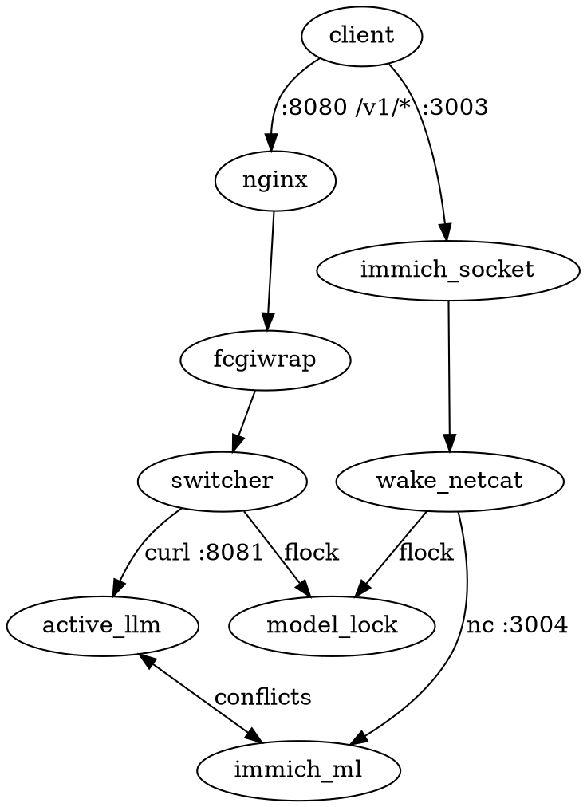

# AGENTS.md — GMKtec EVO-X2 AI Inference & Immich Architecture

This document describes the design, strict contracts, and runtime lifecycle for the **GMKtec EVO-X2** (AMD Ryzen AI Max+ 395 128GB Unified Memory APU) running a bare-minimal NixOS configuration.

---

## 1. High-Level Architecture Overview



### Key Principles:
1. **Single Workload in Memory (Rule 1)**: The 128 GB unified memory pool is shared between Zen 5 CPU cores and the RDNA 3.5 iGPU. To eliminate OOM errors and VRAM thrashing, **exactly one** memory-intensive service (an LLM or the Immich ML engine) is active at any time.
2. **Independent Lock Protocol (Rule 5)**: Synchronization is strictly decoupled from Nginx or FastCGI. Any component orchestrating model lifecycle acquires `/run/model-lock/model.lock` via `flock`.
3. **Mutual Systemd Conflicts**: All generated model units and `immich-machine-learning.service` declare mutual `conflicts`. Starting unit B immediately causes systemd to terminate unit A with `SIGINT`.
4. **Strict Model Contract**: Zero normalization boilerplate in `modules/models.nix`. All builder helpers (`mkGufo`, `mkLlamaCpp`) return objects adhering directly to the contract.

---

## 2. Global Model Registry & Strict Contract

Models are defined in `modules/models.nix` within `services.models.<model_id>`.

### The Contract
Every model entry in `services.models` MUST adhere to the following attribute schema:

```nix
{
  serviceName,     # String: systemd service unit name (e.g. "gufo-qwen3.8-flash-next.service")
  remappedModel,   # String: model identifier expected by the backend engine
  url,             # String: HTTP loopback URL (e.g. "http://127.0.0.1:8081")
  systemdService,  # AttrSet: standard NixOS systemd.services unit configuration
  description,     # (Optional) String: human-readable description for dashboard (default: "")
}
```

### Helper Functions

#### `mkGufo` (`modules/gufo/mkGufo.nix`)
Generates a Gufo inference service running native ROCm/GGUF:
```nix
"qwen3.8-flash-next" = mkGufo {
  modelId = "qwen3.8-flash-next";
  description = "Qwen 3.8 Flash Next UD-Q4_K_XL with MTP speculative decoding & vision";
  modelPath = "qwen3.8-flash-next/UD-Q4_K_XL";
  mmprojPath = "qwen3.8-flash-next/mmproj-BF16.gguf";
  speculative = "mtp";
  mtpModelPath = "qwen3.8-flash-next/MTP/mtp-Qwen3.8-Flash-Next-shared-Q8_0.gguf";
  sessions = 1;
};
```

#### `mkLlamaCpp` (`modules/llama-cpp/mkLlamaCpp.nix`)
Generates a `llama-server` service for any standard GGUF model:
```nix
"llama-3.2-3b" = mkLlamaCpp {
  modelId = "llama-3.2-3b";
  description = "Llama 3.2 3B Instruct via llama-server";
  modelPath = "llama-3.2-3b/Llama-3.2-3B-Instruct-Q8_0.gguf";
  gpuLayers = 99; # Offload all layers to GPU
};
```

#### Custom Services
You can also manually wire any arbitrary OpenAI-compatible service without helper functions:
```nix
"my-service" = {
  serviceName = "my-custom.service";
  remappedModel = "actual-model-name";
  url = "http://127.0.0.1:9090";
  description = "Custom inference server";
  systemdService = { ... };
};
```

It is **highly** advised to create your own `mkMyService` helper function to enforce the strict contract and avoid boilerplate.

---

## 3. Independent Model Lock Protocol

- **Lock File**: `/run/model-lock/model.lock`
- **State File**: `/run/model-lock/active_model`
- **Permissions**: Created at boot by `systemd.tmpfiles.rules` (`0777 root root`), eliminating runtime `mkdir` calls.

### Switching Flow:
1. Process opens file descriptor 9 to `/run/model-lock/model.lock`.
2. Acquires exclusive lock: `flock -x 9`.
3. Checks `/run/model-lock/active_model`.
4. If target workload differs from active workload:
   - Stops active workload / triggers `systemctl start <target_service>`.
   - Polls target HTTP health endpoint until responsive (or deadline).
   - Writes active workload identifier to `/run/model-lock/active_model`.
5. Releases lock: `flock -u 9`.

---

## 4. Main Gateway & Switcher (`modules/dash/`)

The gateway runs on **port 8080**:
- **`/` & `/index.html`**: Wire-speed static HTML dashboard (`modules/dash/dashboard.html`).
- **`/api/*`**: Python FastAPI/CGI wrapper (`modules/dash/dash.py`) for system memory, VRAM/GTT telemetry, and manual switching.
- **`/v1/*`**: Hot-path Bash + `jq` switcher (`modules/dash/switcher.sh`).

### Model Remapping (Rule 2)
When an incoming request arrives with a JSON body:
1. `switcher.sh` extracts `.model`.
2. Looks up the model in `models-registry.json`.
3. If not currently loaded, activates it via the independent lock.
4. Rewrites the request body: `.model = $REMAPPED_MODEL`.
5. Forwards to `$TARGET_URL` with zero-buffering SSE streaming.

### Models Discovery
`GET /v1/models` returns an OpenAI-compliant list of all configured models directly from the declarative registry without waking idle services.

---

## 5. Immich Machine Learning Server (`modules/immich/`)

The GMKtec EVO-X2 can act as a remote ML acceleration server for an Immich instance.
- **Public Port**: `3003` (standard Immich ML port)
- **Internal Backend Port**: `3004` (loopback)

### Netcat Wake-on-Request Socket Activation:
1. **Systemd Socket** (`immich-ml-listener.socket`) listens on port 3003. When idle, 0 bytes of VRAM are used.
2. When Immich sends photo inference requests, socket activation invokes `immich-ml-listener@.service`.
3. The wake script:
   - Takes the independent lock `/run/model-lock/model.lock`.
   - Stops all running LLMs (`gufo-*`, `llama-cpp-*`).
   - Starts `immich-machine-learning.service` on loopback port 3004.
   - Waits for `http://127.0.0.1:3004/ping` to succeed.
   - Forwards client traffic transparently to port 3004 via `nc 127.0.0.1 3004`.
4. If an LLM request arrives later on port 8080, `switcher.sh` takes the lock, stops `immich-machine-learning.service`, and loads the LLM.

---

## 6. Hugging Face Model Downloads

The system includes pre-configured tools for fast GGUF downloads to `/srv/models`:
- **`huggingface-cli`**: Available in system `PATH`.
  ```

---

## 7. System & Memory Safeguards

1. **16GB Swapfile**: Configured at `/var/lib/swapfile` via `swapDevices` to ensure memory headroom during model shard transitions.
2. **Volatile Journald & PAM Limits**: Volatile in-memory logs capped at 32MB and unlimited memlock PAM limits for large model mmap allocations.

---

## 8. Directory Structure

```
.
├── AGENTS.md                   # This architecture guide
├── configuration.nix           # System imports and host configuration
├── flake.nix                   # Flake inputs (nixpkgs, gufo) and outputs
├── hardware-configuration.nix  # Host hardware and disk mounts
└── modules/
    ├── dash/
    │   ├── default.nix         # Gateway Nginx, FastCGI, and switcher script
    │   ├── dashboard.nix       # Dashboard JSON metadata and API script
    │   ├── dash.py             # Telemetry & status Python CGI API
    │   ├── dashboard.html      # Real-time web UI
    │   └── switcher.sh         # Hot-path /v1/* FastCGI switcher with remapping
    ├── gufo/
    │   ├── default.nix         # Gufo user, permissions, and tmpfiles
    │   └── mkGufo.nix          # mkGufo helper implementing strict model contract
    ├── immich/
    │   └── default.nix         # Immich ML service and netcat wake socket
    ├── llama-cpp/
    │   ├── default.nix         # llama-cpp base options and user
    │   └── mkLlamaCpp.nix      # mkLlamaCpp helper implementing strict model contract
    ├── minimal.nix             # Kernel sysctl, 16GB swapfile, hf-download, tools
    ├── models.nix              # Central models registry & mutual conflict wiring
    ├── openssh.nix             # SSH configuration & authorized keys
    └── tailscale.nix           # Tailscale mesh networking
```
