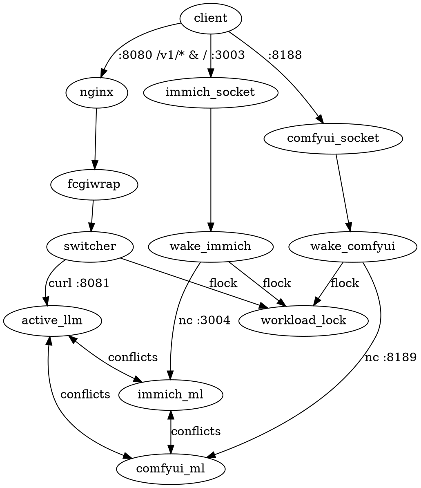

# GMKtec EVO-X2 Unified Workload Architecture

This document describes the design, strict contracts, and runtime lifecycle for the **GMKtec EVO-X2** (AMD Ryzen AI Max+ 395 128GB Unified Memory APU) running a bare-minimal NixOS configuration.

---

## 1. High-Level Architecture Overview



### Key Principles:
1. **Single Workload in Memory (Rule 1)**: The 128 GB unified memory pool is shared between Zen 5 CPU cores and the RDNA 3.5 iGPU. To eliminate OOM errors and VRAM thrashing, **exactly one** memory-intensive service (an active LLM, the Immich ML engine, or ComfyUI) is active at any time.
2. **Three Core Subsystems Supported**:
   - **LLM Subsystem**: Extensible multi-model registry (`gufo`, `llama-cpp`), FastCGI streaming switcher on port 8080 (`/v1/*`), dynamic model switching.
   - **Immich Machine Learning**: Photo ML inference on public port 3003, proxying to loopback port 3004 on demand.
   - **ComfyUI**: Generative AI studio on public port 8188, proxying to loopback port 8189 on demand, packaged declaratively via `github:utensils/comfyui-nix` with pre-built ROCm support (no git clones).
3. **0 MB RAM Footprint on Boot**: Standalone workloads like Immich and ComfyUI run via systemd socket activation. On boot, only listening sockets exist in kernel memory (~0 MB RAM). Heavy backend services only start upon incoming connections.
4. **Eval-Time Calculated Conflicts & Stop Script**: Zero ugly unit globbing (e.g. `systemctl list-units ... "gufo-*"`). All exclusive service units are collected at Nix eval time into `allExclusiveUnits`. A dedicated script (`stop-other-workloads`) stops any active conflicting workloads before starting the target.
5. **Independent Lock Protocol (Rule 5)**: Synchronization is strictly decoupled from Nginx or FastCGI. Any component orchestrating model lifecycle acquires `/run/model-lock/model.lock` via `flock`.

---

## 2. Global Model Registry & Strict Contract

LLM models are defined in `modules/models.nix` within `services.models.<model_id>`.

### The Contract
Every model entry in `services.models` MUST adhere to the following attribute schema:

```nix
{
  serviceName,     # String: systemd service unit name (e.g. "gufo-qwen3.8-flash-next.service")
  remappedModel,   # String: model identifier expected by the backend engine
  url,             # String: HTTP loopback URL (e.g. "http://127.0.0.1:8081")
  systemdService,  # AttrSet: standard NixOS systemd.services unit configuration
  description,     # (Optional) String: human-readable description for dashboard (default: "")
  type,            # (Optional) String: engine identifier ("gufo" | "llama-cpp")
}
```

### Helper Functions

#### `mkGufo` (`modules/gufo/mkGufo.nix`)
Generates a Gufo inference service running native ROCm/GGUF:
```nix
"qwen3.8-flash-next" = mkGufo {
  modelId = "qwen3.8-flash-next";
  description = "Qwen 3.8 Flash Next UD-Q4_K_XL with MTP speculative decoding & vision";
  modelPath = "qwen3.8-flash-next/UD-Q4_K_XL";
  mmprojPath = "qwen3.8-flash-next/mmproj-BF16.gguf";
  speculative = "mtp";
  mtpModelPath = "qwen3.8-flash-next/MTP/mtp-Qwen3.8-Flash-Next-shared-Q8_0.gguf";
  sessions = 1;
};
```

#### `mkLlamaCpp` (`modules/llama-cpp/mkLlamaCpp.nix`)
Generates a `llama-server` service for any standard GGUF model with ROCm acceleration:
```nix
"llama-3.2-3b" = mkLlamaCpp {
  modelId = "llama-3.2-3b";
  description = "Llama 3.2 3B Instruct via llama-server";
  modelPath = "llama-3.2-3b/Llama-3.2-3B-Instruct-Q8_0.gguf";
  gpuLayers = 99;      # Offload all layers to RDNA 3.5 iGPU
  parallel = 1;        # Single server slot to avoid multiplying KV cache VRAM
  flashAttention = true; # Flash Attention enabled for APU memory bandwidth scaling
  threads = 16;        # Match physical Zen 5 cores (Ryzen AI Max+ 395)
  jinja = true;        # Proper chat template formatting & reasoning tags
};
```

---

## 3. Workload Orchestration & Lock Protocol (`modules/workload-manager.nix`)

- **Lock File**: `/run/model-lock/model.lock`
- **State File**: `/run/model-lock/active_model`
- **Permissions**: Created at boot by `systemd.tmpfiles.rules` (`0777 root root`).

### Workload Switching Flow:
1. Process opens file descriptor 9 to `/run/model-lock/model.lock`.
2. Acquires exclusive lock: `flock -x 9`.
3. Checks `/run/model-lock/active_model`.
4. If target workload differs from active workload:
   - Executes eval-time generated `stop-other-workloads <target_unit>` which checks and cleanly terminates any running unit in `allExclusiveUnits`.
   - Starts target workload: `systemctl start <target_service>`.
   - Polls target health check endpoint until responsive (or timeout).
   - Writes active workload identifier to `/run/model-lock/active_model`.
5. Releases lock: `flock -u 9`.

---

## 4. Generic On-Demand Socket Activation (`modules/on-demand/mkWakeScript.nix`)

Both Immich ML and ComfyUI use the generic `mkWakeScript` helper:
- **Immich ML (`modules/immich/default.nix`)**: Listens on `:3003` -> forwards to `:3004` on request.
- **ComfyUI (`modules/comfyui/default.nix`)**: Listens on `:8188` -> forwards to `:8189` on request. Packaged via `github:utensils/comfyui-nix` with pre-built ROCm wheels.

### Lifecycle:
1. Only `<name>-listener.socket` is enabled on boot (`wantedBy = ["sockets.target"]`).
2. When a TCP client connects, systemd spawns `<name>-listener@.service`.
3. Handler acquires the lock, calls `stop-other-workloads`, starts the backend, verifies health, and transparently connects client traffic via `nc 127.0.0.1 <backendPort>`.

---

## 5. Main Gateway & Dashboard (`modules/dash/`)

The gateway runs on **port 8080**:
- **`/` & `/index.html`**: Static HTML dashboard with real-time hardware telemetry and live service status indicators in the footer (`modules/dash/dashboard.html`).
- **`/api/status`**: Dynamic API returning system memory, GPU VRAM & GTT, active workload, models list, and status pills for all defined services (Gateway, Immich ML, ComfyUI).
- **`/v1/*`**: Hot-path Bash + `jq` switcher (`modules/dash/switcher.sh`) with request model remapping and automatic workload unloading.

---

## 6. Directory Structure

```
.
├── AGENTS.md                   # Architecture guide
├── configuration.nix           # Host configuration and module imports
├── flake.nix                   # Flake inputs (nixpkgs, gufo, comfyui-nix, disko)
├── hardware-configuration.nix  # Host hardware and disk mounts
└── modules/
    ├── comfyui/
    │   └── default.nix         # ComfyUI on-demand service (flake-native)
    ├── dash/
    │   ├── default.nix         # Gateway Nginx, FastCGI, and switcher script
    │   ├── dashboard.nix       # Dashboard JSON metadata
    │   ├── dash.py             # Telemetry & status Python CGI API
    │   ├── dashboard.html      # Real-time web UI with service status indicators
    │   └── switcher.sh         # Hot-path /v1/* FastCGI switcher with remapping
    ├── gufo/
    │   ├── default.nix         # Gufo user, permissions, and tmpfiles
    │   └── mkGufo.nix          # mkGufo helper implementing strict model contract
    ├── immich/
    │   └── default.nix         # Immich ML service and netcat wake socket
    ├── llama-cpp/
    │   ├── default.nix         # llama-cpp base options and user
    │   └── mkLlamaCpp.nix      # mkLlamaCpp helper implementing strict model contract
    ├── on-demand/
    │   └── mkWakeScript.nix    # Generic netcat wake-on-request script generator
    ├── minimal.nix             # Kernel sysctl, 16GB swapfile, hf-download, tools
    ├── models.nix              # Central models registry & workload coordinator
    ├── network.nix             # Static IP, DNS nameservers & gateway networking
    ├── nix.nix                 # Nix daemon, flakes, GC, and nix-command options
    ├── pkgs.nix                # System utility packages
    ├── tailscale.nix           # Tailscale mesh networking
    ├── users.nix               # User accounts & SSH keys
    └── workload-manager.nix    # Central eval-time exclusive workload manager
```
