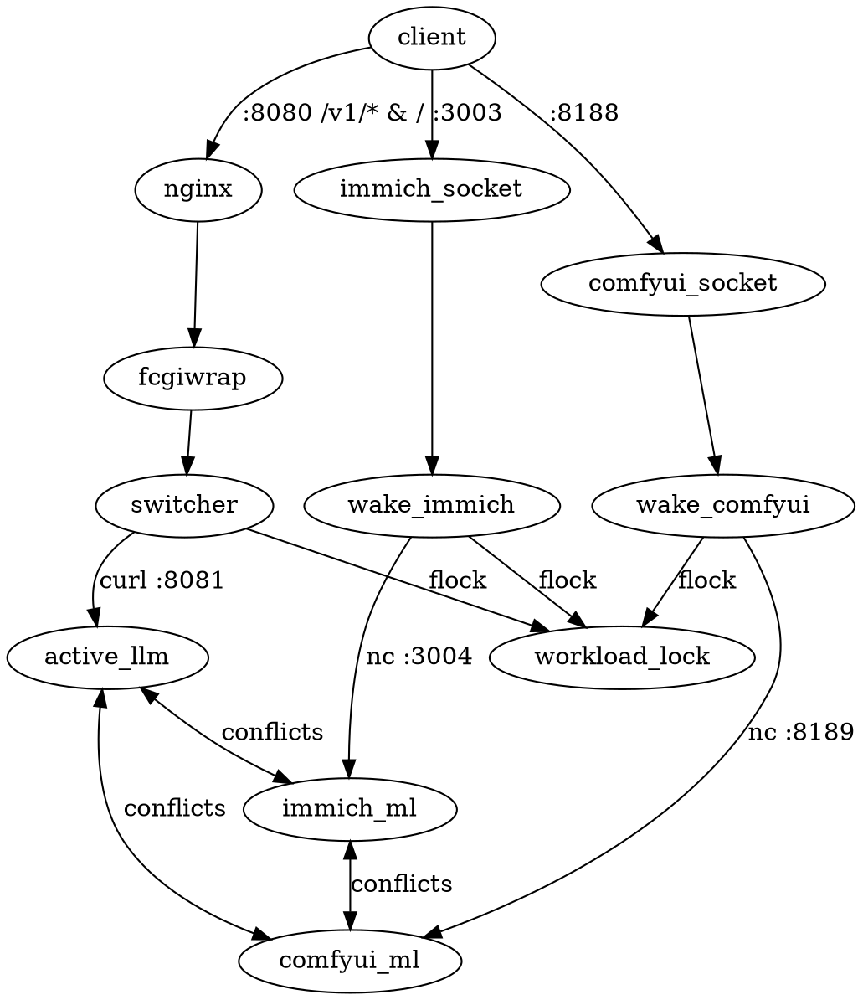

# GMKtec EVO-X2 Unified Workload Architecture

This document describes the design, strict contracts, and runtime lifecycle for the **GMKtec EVO-X2** (AMD Ryzen AI Max+ 395 128GB Unified Memory APU) running a bare-minimal NixOS configuration.

---

## 1. High-Level Architecture Overview



### Key Principles:
1. **Single Workload In Memory Per Domain (Rule 1)**: The 128 GB unified memory pool is shared between Zen 5 CPU cores, the RDNA 3.5 iGPU and the XDNA 2 NPU. To eliminate OOM errors and VRAM thrashing, **exactly one** memory-intensive service is active per *domain*: the GPU domain holds one of (an active LLM, the Immich ML engine, ComfyUI) and the NPU domain holds one `npu-*` runner. The two domains may be loaded simultaneously - a 2 W NPU chat model never displaces a 300 GB GPU LLM.
2. **Three Core Subsystems Supported**:
   - **LLM Subsystem**: Extensible multi-model registry (`gufo`, `llama-cpp`), FastCGI streaming switcher on port 8080 (`/v1/*`), dynamic model switching.
   - **Immich Machine Learning**: Photo ML inference on public port 3003, proxying to loopback port 3004 on demand.
   - **ComfyUI**: Generative AI studio on public port 8188, proxying to loopback port 8189 on demand, packaged declaratively via `github:utensils/comfyui-nix` with pre-built ROCm support (no git clones).
3. **0 MB RAM Footprint on Boot**: Standalone workloads like Immich and ComfyUI run via systemd socket activation. On boot, only listening sockets exist in kernel memory (~0 MB RAM). Heavy backend services only start upon incoming connections.
4. **Eval-Time Calculated Conflicts & Stop Script**: Zero ugly unit globbing (e.g. `systemctl list-units ... "gufo-*"`). All exclusive service units are collected at Nix eval time, per domain, into `gpuExclusiveUnits` and `npuExclusiveUnits`. A dedicated script (`stop-other-workloads <device> <target_unit>`) stops any active conflicting workloads **of that domain** before starting the target. The device argument is mandatory: there is no silent GPU fallback and no way to evict across domains by accident.
5. **Independent Lock Protocol (Rule 5)**: Synchronization is strictly decoupled from Nginx or FastCGI. Any component orchestrating workload lifecycle acquires that domain's lock (`/run/model-lock/gpu.lock` or `/run/model-lock/npu.lock`) via `flock`. A request locks **only its own domain**, so an NPU switch never waits behind a GPU model load and no cross-domain lock ordering (and therefore no deadlock) can arise.
6. **NPU Is A First-Class Domain (`modules/npu/`)**: AMD's proprietary Ryzen AI stack is a *derivation* (`modules/npu/packages/ryzen-ai.nix`, fetched by hash, executable-stack fixed, `installCheckPhase` asserts the VitisAI EP registers) - never a shell installer. Each NPU model is one runner process, exactly like `gufo`/`llama-server`: `mkNpuModel` renders a launcher + unit, and switching workloads means stopping one unit and starting another. See `modules/npu/README.md`.

---

## 2. Global Model Registry & Strict Contract

LLM models are defined in `modules/models.nix` within `services.models.<model_id>`.

### The Contract
Every model entry in `services.models` MUST adhere to the following attribute schema:

```nix
{
  serviceName,     # String: systemd service unit name (e.g. "gufo-qwen3.8-flash-next.service")
  remappedModel,   # String: model identifier expected by the backend engine
  url,             # String: HTTP loopback URL (e.g. "http://127.0.0.1:8081")
  systemdService,  # AttrSet: standard NixOS systemd.services unit configuration
  description,     # (Optional) String: human-readable description for dashboard (default: "")
  type,            # (Optional) String: engine identifier ("gufo" | "llama-cpp" | "kyojin" | "npu-genai" | "npu-embeddings")
  sessions,        # (Optional) Int: maximum concurrent sessions / slots (default: 1)
  device,          # (Optional) String: "gpu" (default) | "npu" - which domain's lock/unit set it joins
  capabilities,    # (Optional) List String: OpenAI routes the runner serves ("chat",
                   #            "completions", "embeddings", ...); drives the dashboard badges
  modelDir,        # (Optional) String: absolute weights dir, pre-flighted by the gateway and
                   #            by ExecStartPre so a missing download fails fast
}
```

### Helper Functions

#### `mkGufo` (`modules/gufo/mkGufo.nix`)
Generates a Gufo inference service running native ROCm/GGUF:
```nix
"qwen3.8-flash-next" = mkGufo {
  modelId = "qwen3.8-flash-next";
  description = "Qwen 3.8 Flash Next UD-Q4_K_XL with MTP speculative decoding & vision";
  modelPath = "qwen3.8-flash-next/UD-Q4_K_XL";
  mmprojPath = "qwen3.8-flash-next/mmproj-BF16.gguf";
  speculative = "mtp";
  mtpModelPath = "qwen3.8-flash-next/MTP/mtp-Qwen3.8-Flash-Next-shared-Q8_0.gguf";
  sessions = 1;
};
```

#### `mkLlamaCpp` (`modules/llama-cpp/mkLlamaCpp.nix`)
Generates a `llama-server` service for any standard GGUF model with ROCm acceleration:
```nix
"llama-3.2-3b" = mkLlamaCpp {
  modelId = "llama-3.2-3b";
  description = "Llama 3.2 3B Instruct via llama-server";
  modelPath = "llama-3.2-3b/Llama-3.2-3B-Instruct-Q8_0.gguf";
  gpuLayers = 99;      # Offload all layers to RDNA 3.5 iGPU
  parallel = 1;        # Single server slot to avoid multiplying KV cache VRAM
  flashAttention = true; # Flash Attention enabled for APU memory bandwidth scaling
  threads = 16;        # Match physical Zen 5 cores (Ryzen AI Max+ 395)
  jinja = true;        # Proper chat template formatting & reasoning tags
};
```

#### `mkNpuModel` (`modules/npu/mkNpuModel.nix`)
Generates an AMD Ryzen AI (XDNA 2) runner service. One process, one model, one port - the same
engine shape as `mkGufo`, selected by `kind` (`genai` | `embeddings` | `asr` | `image-gen`):
```nix
"llama-3.2-1b-npu" = mkNpuModel {
  modelId = "llama-3.2-1b-npu";
  remappedModel = "Llama-3.2-1B-Instruct_rai_1.9.0_npu";
  description = "Llama 3.2 1B Instruct int4 on the Ryzen AI NPU - light chat alongside the GPU LLM";
  kind = "genai";        # -> runners/genai_runner.py, capabilities [chat, completions]
  port = 8083;
};
```
`modelPath` defaults to `modelId` and resolves against `services.npu.modelsDir`; the resulting
`modelDir` is checked in `ExecStartPre` so weights that are not installed fail in the journal
with the missing path instead of hanging the gateway. Weights are host state - no unit or
module in this repo downloads anything.

#### `mkKyojin` (`modules/kyojin/mkKyojin.nix`)
Generates an ExLlamaV3/Kyojin inference service running native ROCm on gfx1151:
```nix
"glm-5.3-flash" = mkKyojin {
  modelId = "glm-5.3-flash";
  description = "GLM-5.3-Flash EXL3 (320B total, 18B active) with MTP speculative decoding & vision";
  modelPath = "glm-5.3-flash";
  flavor = "glm";
  context = 524288; # Max context fitting in 128GB unified RAM (~118 GiB footprint)
  numDraft = 2;
  sessions = 1;
};
```

---

Registry keys are canonical: `wantedBy`/dashboard lookups match on `modelId`, never on
`remappedModel`.

---

## 3. Workload Orchestration & Lock Protocol (`modules/workload-manager.nix`)

Everything is keyed by **device domain** - `gpu` and `npu` never share a lock, a state file, or
a conflict set:

| | GPU domain | NPU domain |
| --- | --- | --- |
| Lock file | `/run/model-lock/gpu.lock` | `/run/model-lock/npu.lock` |
| State file | `/run/model-lock/active_gpu` | `/run/model-lock/active_npu` |
| Unit set | `gpuExclusiveUnits` | `npuExclusiveUnits` |
| systemd `Conflicts=` | within the GPU set only | within the NPU set only |

Permissions: created at boot by `systemd.tmpfiles.rules` (`0777 root root`). There are no
legacy `model.lock` / `active_model` symlinks - an `os.path.exists()` check on a dangling
compat link is a false positive waiting to happen.

### Workload Switching Flow (per domain):
1. Process opens file descriptor 9 to `/run/model-lock/<device>.lock` where `<device>` comes from the target model's `device` attribute.
2. Acquires exclusive lock: `flock -x 9`.
3. Checks `/run/model-lock/active_<device>`.
4. If the target workload differs from the active workload of that domain:
   - Executes eval-time generated `stop-other-workloads <device> <target_unit>`, which cleanly terminates any running unit in that domain's exclusive set. The device argument is required; passing the wrong one is an error rather than a silent GPU fallback.
   - Starts target workload: `systemctl start <target_service>`.
   - Polls the target health endpoint until responsive (or timeout).
   - Writes the active workload identifier to `/run/model-lock/active_<device>`.
5. Releases lock: `flock -u 9`.

Because a request only ever touches its own domain's lock, an NPU switch never queues behind a
GPU model load, and the stop script cannot evict across domains by accident.

---

## 4. Generic On-Demand Socket Activation (`modules/on-demand/mkWakeScript.nix`)

Both Immich ML and ComfyUI use the generic `mkWakeScript` helper:
- **Immich ML (`modules/immich/default.nix`)**: Listens on `:3003` -> forwards to `:3004` on request.
- **ComfyUI (`modules/comfyui/default.nix`)**: Listens on `:8188` -> forwards to `:8189` on request. Packaged via `github:utensils/comfyui-nix` with pre-built ROCm wheels.

### Lifecycle:
1. Only `<name>-listener.socket` is enabled on boot (`wantedBy = ["sockets.target"]`).
2. When a TCP client connects, systemd spawns `<name>-listener@.service`.
3. Handler acquires the lock **of its own domain** (`device` is part of the wake-script config, `gpu` by default), calls `stop-other-workloads <device> <unit>`, starts the backend, verifies health, and transparently connects client traffic via `nc 127.0.0.1 <backendPort>`.

---

## 5. Main Gateway & Dashboard (`modules/dash/`)

The gateway runs on **port 8080**:
- **`/` & `/index.html`**: Static dashboard built from the frontend project (`modules/dash/frontend/`, served from the `modules/dash/frontend.nix` derivation).
- **`/assets/*`**: Content-hashed JS/CSS bundles, served with `Cache-Control: public, max-age=31536000, immutable`; `index.html` is served with `no-cache` so a rebuild is picked up immediately.
- **`/api/status`**: Dynamic API returning system memory, GPU VRAM & GTT, NPU busy/state, the active workload **of each domain**, the models list, and status for all defined services (Gateway, Immich ML, ComfyUI).
- **`/v1/*`**: Hot-path Bash + `jq` switcher (`modules/dash/switcher.sh`) with request model remapping, per-domain routing and automatic workload unloading.

### Dual-domain API contract (`modules/dash/dash.py`)

The two domains are reported and controlled separately - nothing in the API implies a single
"active model" anymore:

| field / route | meaning |
| --- | --- |
| `active_gpu_model` | model loaded on the iGPU (from `/run/model-lock/active_gpu`), `null` when idle |
| `active_npu_model` | model loaded on the XDNA 2 NPU (from `/run/model-lock/active_npu`), `null` when idle |
| `models[].device` | `"gpu"` or `"npu"` - which domain a model belongs to |
| `models[].capabilities` | routes the runner serves (`chat`, `completions`, `embeddings`, …) |
| `models[].model_dir` | weights path, pre-flight-checked by the switcher before starting anything |
| `POST /api/switch {model}` | domain is derived from the model itself - the client never picks a lock |
| `POST /api/stop {device}` | unload **one** domain; `device` is explicit so the dashboard can never evict the other side |

`/v1/models` is served by the gateway from the registry (the runners deliberately expose no
`/v1/models` of their own - one process, one model), and it includes `device` + `capabilities`.

### Dashboard UI (`modules/dash/frontend/`)

Tailwind CSS 4 + **daisyUI 5** (`data-theme="halloween"`) + **Lightweight Charts™** (TradingView), bundled by esbuild. Zero runtime CDN: everything is bundled into two content-hashed files.

Frontend state mirrors the two domains: `state.active` and `state.switching` are `{gpu, npu}`
objects (`src/js/state.js` exposes `DEVICES`, `modelsOfDevice()`, `inferenceTarget(device)`),
the workload card renders one sub-card per domain with its own unload button, model cards carry
a GPU/NPU badge plus capability badges, and the Playground has a domain selector so a chat can
be pointed at the iGPU LLM or the NPU LLM independently.

Documentation for the libraries can be found at `https://daisyui.com/llms.txt` and `https://tradingview.github.io/lightweight-charts/docs_map.md`, only access it if needed.

### Frontend build
- `frontend.nix` uses `buildNpmPackage` (`npm ci --offline` against `package-lock.json`, `npmDepsHash` pinned) and produces a plain static directory: `index.html` + `assets/app.<hash>.{js,css}`. Nothing Node-related lands in the runtime closure.
- Local iteration without Nix: `cd modules/dash/frontend && npm ci && npm run build` (output in `frontend/dist`).
- `package-lock.json` is trimmed to **linux/x64** binaries (`npm run lockfile` → `scripts/prune-lockfile.mjs`), because the `npmDepsHash` prefetch downloads every tarball the lockfile lists (96 → 41). `frontend.nix` fails the `checkPhase` if a foreign-platform binary sneaks back in.
- After changing `package.json`/`package-lock.json`, refresh `npmDepsHash`: set it to `lib.fakeHash`, build, and copy the reported `got: sha256-…` back in.

---

## 6. Directory Structure

```
.
├── AGENTS.md                   # Architecture guide
├── configuration.nix           # Host configuration and module imports
├── flake.nix                   # Flake inputs (nixpkgs, gufo, comfyui-nix, disko)
├── hardware-configuration.nix  # Host hardware and disk mounts
└── modules/
    ├── comfyui/
    │   └── default.nix         # ComfyUI on-demand service (flake-native)
    ├── dash/
    │   ├── default.nix         # Gateway Nginx, FastCGI, and switcher script
    │   ├── frontend.nix        # buildNpmPackage: Tailwind/daisyUI/Lightweight Charts -> static site
    │   ├── frontend/           # Frontend source (package.json + lockfile pin the toolchain)
    │   │   ├── build.mjs       # esbuild + Tailwind CLI build, content-hashed asset names
    │   │   └── src/
    │   │       ├── index.html  # Markup template (halloween theme, asset markers)
    │   │       ├── css/app.css # Tailwind entry (@plugin "daisyui" with the halloween theme)
    │   │       └── js/         # main.js + api, charts, models, playground, services, workload
    │   ├── dash.py             # Telemetry & status Python CGI API
    │   └── switcher.sh         # Hot-path /v1/* FastCGI switcher with remapping
    ├── gufo/
    │   ├── default.nix         # Gufo user, permissions, and tmpfiles
    │   └── mkGufo.nix          # mkGufo helper implementing strict model contract
    ├── immich/
    │   └── default.nix         # Immich ML service and netcat wake socket
    ├── kyojin/
    │   ├── default.nix         # Kyojin user, permissions, and tmpfiles
    │   └── mkKyojin.nix        # mkKyojin helper implementing strict model contract
    ├── llama-cpp/
    │   ├── default.nix         # llama-cpp base options and user
    │   └── mkLlamaCpp.nix      # mkLlamaCpp helper implementing strict model contract
    ├── on-demand/
    │   └── mkWakeScript.nix    # Generic netcat wake-on-request script generator
    ├── npu/
    │   ├── README.md           # NPU domain: packaging decisions, validated stack, AMD blockers
    │   ├── default.nix         # services.npu: user, accel device, runtime env, stack self-check
    │   ├── mkNpuModel.nix      # mkNpuModel helper implementing strict model contract
    │   ├── packages/
    │   │   ├── ryzen-ai.nix    # AMD Ryzen AI 1.9.0 runtime as derivations (hash-pinned)
    │   │   ├── amdxdna-driver.nix  # XRT's out-of-tree amdxdna.ko (services.npu.xrtDriver)
    │   │   └── strip-execstack.py  # clears PT_GNU_STACK X (kernel >= 6.6 rejects on dlopen)
    │   └── runners/
    │       ├── npu_http.py     # shared /health + SSE streaming + one-session lock
    │       ├── genai_runner.py # onnxruntime-genai -> /v1/chat/completions, /v1/completions
    │       └── embeddings_runner.py # ONNX + VitisAI EP -> /v1/embeddings
    ├── minimal.nix             # Kernel sysctl, 16GB swapfile, hf-download, tools
    ├── models.nix              # Central models registry & workload coordinator
    ├── network.nix             # Static IP, DNS nameservers & gateway networking
    ├── nix.nix                 # Nix daemon, flakes, GC, and nix-command options
    ├── pkgs.nix                # System utility packages
    ├── tailscale.nix           # Tailscale mesh networking
    ├── users.nix               # User accounts & SSH keys
    └── workload-manager.nix    # Central eval-time exclusive workload manager
```

---

## 7. Driver and artifact constraints (NPU domain)

Validated on this host (`llm`, kernel 7.2.9): LLM generation runs on the NPU (`59.3 tok/s` on
Llama-3.2-1B int4), AMD's quicktest CNN executes on the NPU (`NPU kernel time: 3234 us`) with
CPU-identical numerics, and the packaged runtime registers `VitisAIExecutionProvider`.

1. **LLM/genai needs AMD's out-of-tree driver - solved by `services.npu.xrtDriver`.** With
   mainline's `amdxdna` every LLM session died in
   `DRM_IOCTL_AMDXDNA_CREATE_BO failed (err=-14: Bad address)` /
   `amdxdna_get_ubuf: Failed to pin pages ret -14`: the in-tree driver is 0.10.0-era and has no
   `amdxdna_ubuf_get_pages`, no `amdxdna_dpt.c` and no `npu6_regs`, while the Ryzen AI userspace
   is 2.2x-era. AMD develops the driver out-of-tree (`amd/xdna-driver`) and ships it inside XRT;
   `packages/amdxdna-driver.nix` builds exactly that tree (plus XRT's `configure_kernel.sh`
   feature probes) for `boot.kernelPackages` and installs `updates/amdxdna.ko`, which depmod
   prefers over the in-tree module. **A plain `nix flake update` cannot fix the gap** - there is
   no synced mainline release to move to. Enabling the option needs a reboot (or
   `rmmod amdxdna && insmod …/updates/amdxdna.ko`) to take effect.
2. **EmbeddingGemma NPU artifact** - `com.ryzenai:CastAvx` is referenced by the only published
   artifact and registered by no 1.8/1.9 runtime ([amd/RyzenAI-SW#387](https://github.com/amd/RyzenAI-SW/issues/387)).
   `runners/embeddings_runner.py` is code-complete (including the artifact's `metadata_int8`
   schema drift) and the registry entry stays commented out with this reason.

Full notes: `modules/npu/README.md`.
