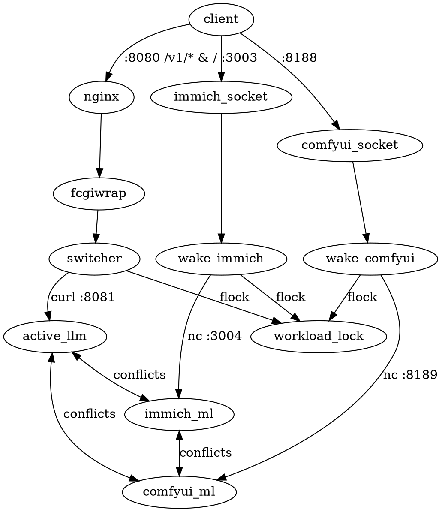

# GMKtec EVO-X2 Unified Workload Architecture

This document describes the design, strict contracts, and runtime lifecycle for the **GMKtec EVO-X2** (AMD Ryzen AI Max+ 395 128GB Unified Memory APU) running a bare-minimal NixOS configuration.

---

## 1. High-Level Architecture Overview

### Key Principles:

1. **Single Workload In Memory Per Domain (Rule 1)**: The 128 GB unified memory pool is shared between Zen 5 CPU cores, the RDNA 3.5 iGPU, and the XDNA 2 NPU. To eliminate OOM errors and VRAM thrashing, **exactly one** memory-intensive service is active per *domain*: the GPU domain holds one active engine and the NPU domain holds one `npu-*` runner.
2. **Three Core Subsystems Supported**:
* **LLM Subsystem**: Multi-model registry, resident Rust router daemon on port 8080 (`/v1/*`), and fallback CGI switcher.
* **Immich Machine Learning**: Photo ML inference on public port 3003, proxying to loopback port 3004 on demand.
* **ComfyUI**: Generative AI studio on public port 8188, proxying to loopback port 8189 on demand, packaged declaratively via `github:utensils/comfyui-nix`.

3. **0 MB RAM Footprint on Boot**: Standalone workloads like Immich and ComfyUI use systemd socket activation.
4. **Eval-Time Calculated Conflicts & Stop Script**: Exclusive service units are collected at Nix eval time into `gpuExclusiveUnits` and `npuExclusiveUnits`. A dedicated script (`stop-other-workloads`) terminates conflicting workloads before starting the target.
5. **Independent Lock Protocol (Rule 5)**: Synchronization is decoupled via `flock` on `/run/model-lock/gpu.lock` or `/run/model-lock/npu.lock`.
6. **NPU Is A First-Class Domain (`modules/npu/`)**: Powered by OpenFlowLM (`oflm serve`) with an OpenAI-compatible interface.

---

## 2. Global Model Registry & Strict Contract

Every model is a `services.models.<model_id>` entry. Raw declarations live per hardware domain:

* `models/gpu.nix`: RDNA 3.5 iGPU models (`mkGufo`, `mkLlamaCpp`, `mkKyojin`)
* `models/npu.nix`: XDNA 2 models (`mkOpenFlow`)

### The Contract Schema

Every model entry in `services.models` adheres to:

* `serviceName`: Systemd service unit name.
* `remappedModel`: Identifier expected by the backend engine.
* `url`: HTTP loopback URL.
* `systemdService`: Standard NixOS systemd unit configuration.
* `description`, `type`, `sessions`, `context`, `device`, `capabilities`, `modelDir`.

### Helper Functions

* **`mkGufo`**: Gufo native ROCm/GGUF service.
* **`mkLlamaCpp`**: Standard `llama-server` GGUF service with ROCm acceleration.
* **`mkOpenFlow`**: OpenFlowLM service per model on the XDNA 2 NPU (`chat` or `asr`).
* **`mkKyojin`**: ExLlamaV3/Kyojin inference service running native ROCm on gfx1151.

---

## 3. Workload Orchestration & Lock Protocol

* **GPU Domain**: Lock (`/run/model-lock/gpu.lock`), State (`/run/model-lock/active_gpu`), Unit Set (`gpuExclusiveUnits`).
* **NPU Domain**: Lock (`/run/model-lock/npu.lock`), State (`/run/model-lock/active_npu`), Unit Set (`npuExclusiveUnits`).

---

## 4. Main Gateway & Dashboard (`modules/dash/`)

* **Port 8080**: Serves static dashboard, content-hashed assets (`/assets/*`), telemetry API (`/api/status`), and OpenAI model listing (`/v1/models`).
* **Rust Router Daemon (`modules/switcher/`)**: Zero-dependency `std`-only router handling model resolution, request routing, streaming, and connection pooling.
* **Dashboard UI**: Tailwind CSS 4 + daisyUI 5 + Lightweight Charts™ with dual-domain controls and interactive playgrounds.

---

## 5. NPU Driver and Artifact Constraints

* **OpenFlowLM**: Native OpenAI compatibility with kernels sourced from `openflow-kernels.nix`.
* **Out-of-Tree Driver (`services.npu.xrtDriver`)**: Builds `amdxdna.ko` from XRT to resolve pinning and buffer allocation limitations found in mainline kernel drivers.
